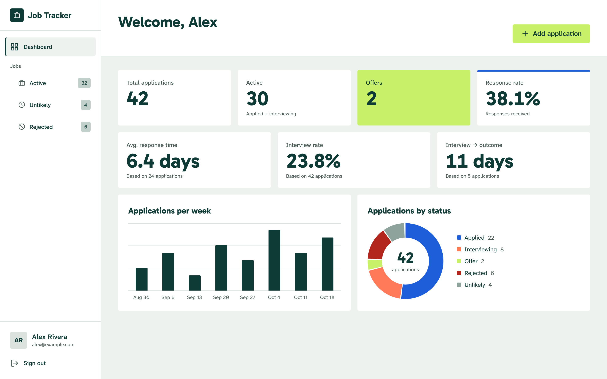
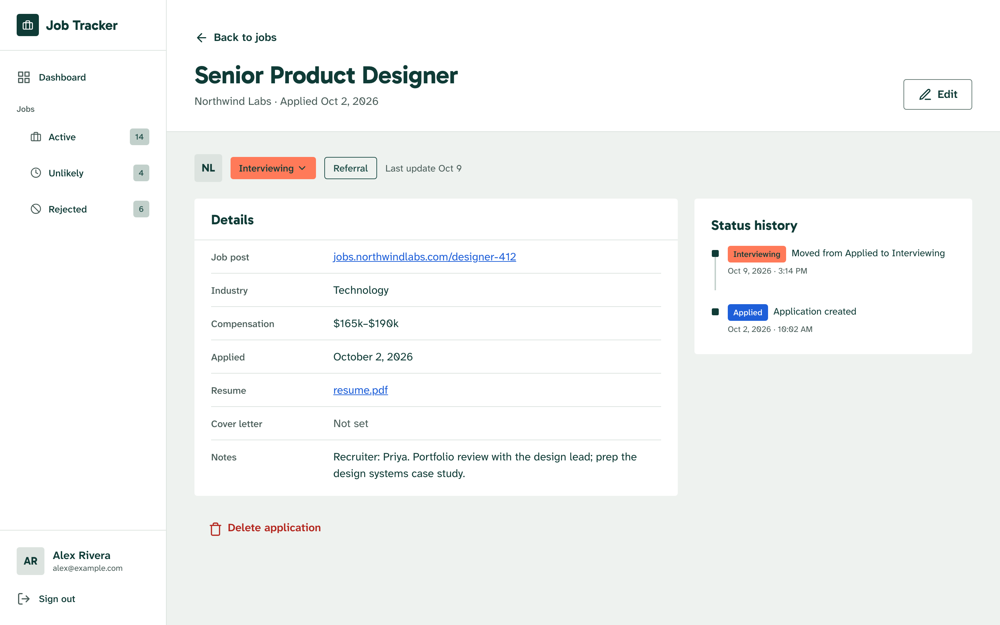
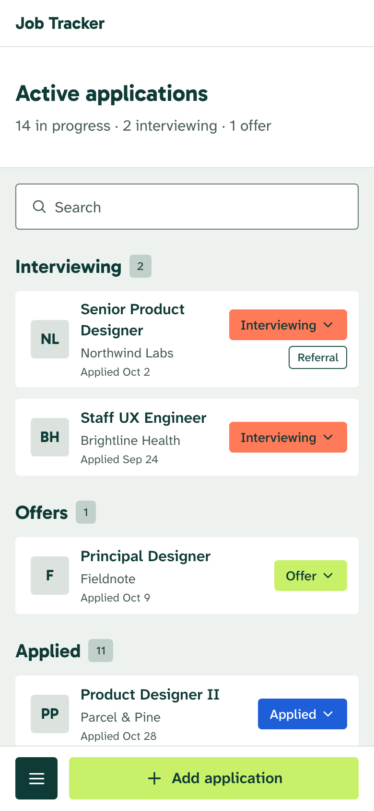
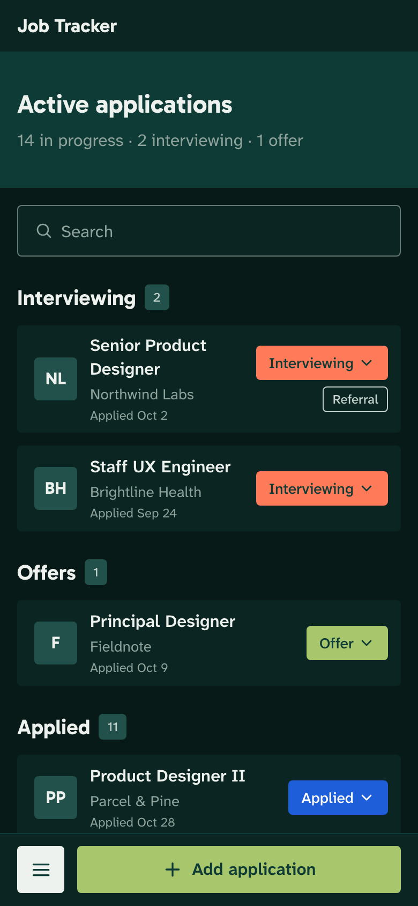
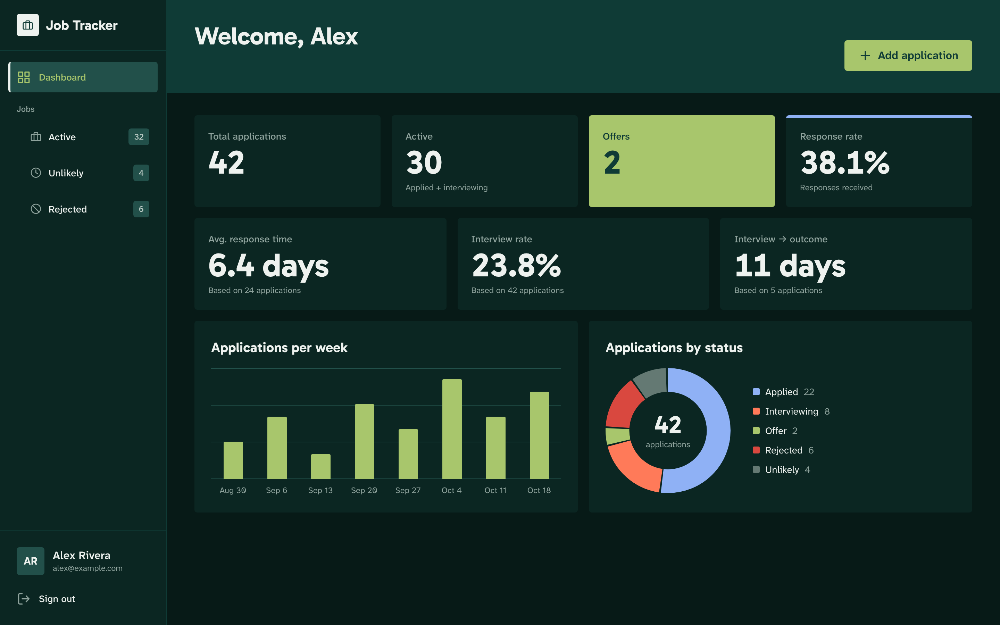

# Job Tracker

A web app for tracking job applications: where you applied, where each one stands, and how your search is going overall.



## Why I built it

- **Spreadsheets got tedious.** I wanted to spend my time on the job search itself, not on maintaining columns, formulas and conditional formatting.
- **I wanted to explore Python on the backend**, so the API is FastAPI.
- **Room to grow.** I'd previously built an AI-driven interview prep app, and this gives it a natural home if I decide to fold it in.

## Features

- **Track applications through their lifecycle:** Applied → Interviewing → Offer, Rejected or Role Eliminated, with a timeline of every status change.
- **Automatic follow-up:** applications with no movement after 14 days are moved to Unlikely by a nightly job, so the active list stays honest.
- **Paste a link to fill in the details:** the backend scrapes the job post's OpenGraph and JSON-LD data for the title, company, logo and compensation.
- **Attach your résumé and cover letter** (PDF). Downloads are short-lived signed URLs.
- **Dashboard:** response rate, interview rate, average response time, applications per week and by status.
- **Light and dark mode**, following your system setting, and a phone layout with its own navigation.

| Application detail | Phone, light and dark |
| --- | --- |
|  |   |



## How it's built

| | |
| --- | --- |
| **Frontend** | React 18, TypeScript, Vite, Tailwind CSS 4, TanStack Query, React Hook Form + Zod |
| **Backend** | Python, FastAPI, APScheduler, Beautiful Soup |
| **Data and auth** | Supabase: Postgres with row-level security, Auth, Storage |
| **Testing** | Vitest, Storybook 10, Playwright, axe, pytest, MSW |
| **Hosting** | Railway (Docker), GitHub Actions |

Some decisions worth calling out:

- **Supabase handles auth only.** The browser never queries the database. Every request goes through the FastAPI backend, which verifies the user's Supabase token and talks to Postgres and Storage. Application queries run with that token too, so Postgres row-level security applies as a second line of defence.
- **A design system built in Figma first.** Colors, type, spacing and motion are tokens that map one-to-one to Figma variables. Dark mode uses CSS `light-dark()` on those tokens rather than a second set of styles, so every component gets it for free.
- **Accessibility is enforced, not hoped for.** Every Storybook story runs as a test in a real browser, including axe accessibility checks; a violation fails the build.
- **Testing in layers.**
  - Backend unit tests with a mocked Supabase.
  - Frontend unit tests against a mocked API.
  - Story tests for every component and screen, with interaction tests in their `play` functions.
  - End-to-end tests that run the real stack: a local Supabase, the API and a production build.

  CI runs all of them on every pull request.

## Running it locally

Requires Node 24, pnpm, Python 3.12 and Docker (for the local Supabase).

```bash
pnpm install
pnpm exec supabase start          # local Postgres, Auth and Storage, seeded with demo data
pnpm exec supabase status         # URL and keys for the .env files below
```

Copy `backend/.env.example` to `backend/.env` and `packages/frontend/.env.example` to `packages/frontend/.env`, then fill them in from `supabase status`.

```bash
# API on :8000
cd backend
python -m venv .venv && source .venv/bin/activate
pip install -r requirements.txt
uvicorn app.main:app --reload --port 8000

# Frontend on :5173 (from the repo root, in another terminal)
pnpm --filter frontend dev
```

Sign in with the demo account (`demo@example.com` / `demo-password`) to see sample data, or create your own account on the Sign up page. Local sign-ups don't need email confirmation.

### Tests

```bash
cd backend && pytest                      # backend

cd packages/frontend
pnpm test:unit                            # unit tests
pnpm test:storybook                       # every story, with accessibility checks
pnpm test:e2e                             # end to end; needs local Supabase and the backend venv active
pnpm storybook                            # browse the components on :6006
```

## Project structure

```
backend/              FastAPI app: routes, nightly job, scraping, tests
packages/frontend/    React app, Storybook stories and E2E tests
packages/shared/      TypeScript types shared across the frontend
supabase/             Migrations, config and the demo seed
```

## What's next

- Error monitoring and observability with Sentry, before opening the app up publicly.
- Possibly bringing in the AI interview prep from my earlier project.
